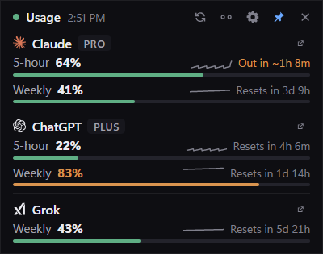
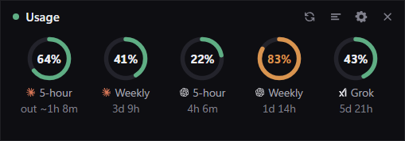
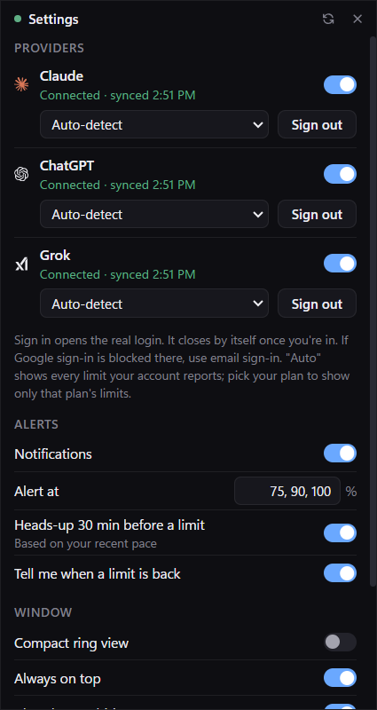
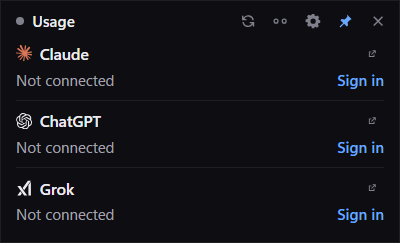

<div align="center">



# AI Usage Tracker

**Your Claude, ChatGPT and Grok limits, live on your desktop — with a heads-up before you run out.**

[](https://github.com/Pengopal/ai-usage-tracker-widget/releases/latest)
[](https://github.com/Pengopal/ai-usage-tracker-widget/actions/workflows/ci.yml)
[](LICENSE)

<sub><b>Built with</b></sub><br>
[](https://www.electronjs.org)
[](https://nodejs.org)
[](https://developer.mozilla.org/docs/Web/JavaScript)
[](https://www.electron.build)
[](https://www.microsoft.com/windows)

**[Download for Windows](https://github.com/Pengopal/ai-usage-tracker-widget/releases/latest)**

</div>

## The problem

Claude, ChatGPT and Grok all ration usage in windows — five hours, a week — and each hides its meter on a
different settings page. You find out you're out when a reply stops halfway.

AI Usage Tracker keeps every limit in one small, always-on-top window, refreshed every minute, and warns you
while there's still time to slow down.

## Features

### Every limit at a glance

One line per limit: how much you've used, when it resets, and a 24-hour trend line. Bars turn orange at 70%
and red at 90%.

| Detailed | Compact rings |
| :---: | :---: |
|  |  |

### Warnings before you run out

- **Pace heads-up**: from your last hour of use, the widget works out when a limit will run out. If that's
  before it resets, you see "Out in ~1h 8m" and get a notification about 30 minutes ahead.
- **Threshold alerts** at the percentages you choose (75, 90 and 100% by default), once per reset window.
- **Limit-back alert** when a limit you'd nearly used up resets.

### Your plan, your providers



Each provider has a switch to show or hide it and a plan picker. **Auto-detect** shows every limit your account
reports and labels the plan it finds. Picking a plan shows only that plan's limits — for example, Claude
**Max 20x** shows just the weekly limit.

| Provider | Limits shown | Plans |
| --- | --- | --- |
| Claude | 5-hour, weekly | Free, Pro, Max 5x, Max 20x, Team, Enterprise |
| ChatGPT | 5-hour, weekly | Free, Plus, Pro, Business, Enterprise |
| Grok | Weekly pool | Free, SuperGrok, SuperGrok Heavy, X Premium, X Premium+ |

### Stays out of the way

Frameless and draggable, sizes itself to its content, remembers where you put it, and lives in the tray. It
updates itself from GitHub Releases and shows an **Update** button when a new version is ready.

<br clear="right">

## Install

1. Download `AI-Usage-Tracker-Setup-<version>.exe` from the
   [latest release](https://github.com/Pengopal/ai-usage-tracker-widget/releases/latest) and run it.
2. Click **Sign in** next to each provider you use.

Until the installer is code-signed, Windows SmartScreen shows "Windows protected your PC" the first time:
click **More info → Run anyway**. [docs/CODE-SIGNING.md](docs/CODE-SIGNING.md) explains why and how signing
is set up.

The portable `AI-Usage-Tracker-Portable-<version>.exe` runs without installing but can't update itself.

To start with Windows: `Win + R` → `shell:startup` → put a shortcut to the app there.

## Signing in

**Sign in** opens the provider's real login page in a window. Sign in as usual; the window closes by itself
once the app can read your usage, and the widget comes back to the front. You do this once per account.

Your password goes only to Anthropic, OpenAI or xAI. The app keeps the sites' normal login cookies in its own
private profile, like a browser does, and **Sign out** deletes them. If "Continue with Google" is blocked in the
sign-in window, use email sign-in.



## How it reads your usage

None of these services offers a public API for personal usage, so the widget reads the same endpoints their
own websites use, from a hidden window signed in as you:

| Provider | Endpoint | Gives |
| --- | --- | --- |
| Claude | `claude.ai/api/organizations/{org}/usage` (behind Settings → Usage) | 5-hour and weekly %, resets, plan tier |
| ChatGPT | `chatgpt.com/backend-api/wham/usage` | 5-hour and weekly %, resets, plan |
| Grok | `grok.com/rest/grok/credits` (falls back to `/rest/rate-limits`) | Weekly pool %, reset |

These are unofficial and can change without notice. When one does, the widget shows "Sync problem" until
it's updated, and the last raw response is saved as `sync-debug-<provider>.json` in the data folder to make the
fix quick.

**Gemini isn't supported.** Google blocks sign-in inside embedded app windows, and the Gemini app doesn't
expose your usage anywhere the widget could read it.

## Data and privacy

Everything stays on your PC, in `%APPDATA%\ai-usage-tracker-widget\`:

| File | Holds |
| --- | --- |
| `usage-data.json` | Last readings and settings |
| `history.json` | Seven days of readings, for pace and trend lines |
| `sync-debug-*.json` | The last raw usage response per provider |
| `Partitions\` | The login sessions |

The app talks only to the three providers and to GitHub (for updates). Delete the folder to reset everything.

## Develop

Requires [Node.js](https://nodejs.org/) 22.

```bash
npm install
```

```bash
npm start
```

```bash
npm test
```

Build the installer and portable exe into `dist/`:

```bash
npm run build
```

| Path | What lives there |
| --- | --- |
| `src/main.js` | Window, tray, sync loop, alerts, IPC |
| `src/sync.js` | Sign-in windows and the per-provider usage readers |
| `src/parsers.js` | Turns each provider's response into the common shape |
| `src/providers.js` | Providers, plans, and which limits each plan shows |
| `src/insights.js` | Burn-rate pace and trend lines from history |
| `src/store.js` | Readings, settings and history on disk |
| `src/updater.js` | Updates from GitHub Releases |
| `src/renderer/` | The widget UI |
| `test/` | Unit tests (`node --test`) |

See [CONTRIBUTING.md](CONTRIBUTING.md) before opening a pull request.

## Releasing

1. Add the changes under a new version heading in [CHANGELOG.md](CHANGELOG.md).
2. Set the same `version` in `package.json`, merge to `main`.
3. Tag it and push the tag:

```bash
git tag v1.2.0
```

```bash
git push origin v1.2.0
```

The [Release workflow](.github/workflows/release.yml) builds the installer on Windows, publishes it with the
changelog section as release notes, and installed apps pick it up within a few hours.

## Security

Please report vulnerabilities privately — see [SECURITY.md](SECURITY.md).

## License

[MIT](LICENSE)
