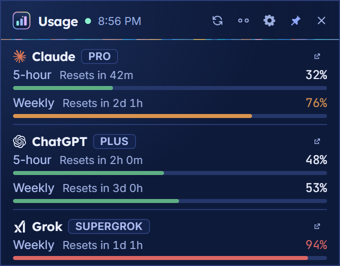
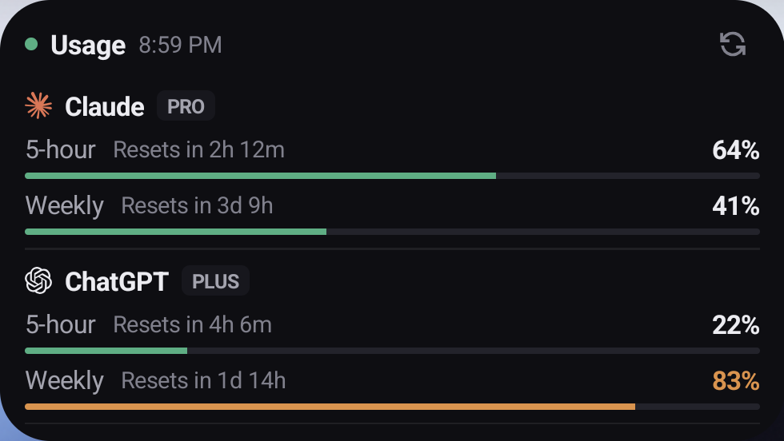

<div align="center">


# AI Usage Tracker

**Your Claude, ChatGPT and Grok limits, live on your desktop and your phone — with a heads-up before you run out.**

[](https://github.com/Pengopal/ai-usage-tracker-widget/releases/latest)
[](https://github.com/Pengopal/ai-usage-tracker-widget/actions/workflows/ci.yml)
[](LICENSE)

<sub><b>Built with</b></sub><br>
[](https://www.electronjs.org)
[](https://nodejs.org)
[](https://kotlinlang.org)
[](https://developer.android.com/jetpack/compose/glance)

**[Download](https://github.com/Pengopal/ai-usage-tracker-widget/releases/latest)**

</div>

## The problem

Claude, ChatGPT and Grok all ration usage in windows — five hours, a week — and each hides its meter on a
different settings page. You find out you're out when a reply stops halfway.

AI Usage Tracker puts every limit in one place, refreshed on its own: an always-on-top window on Windows and a
home-screen widget on Android.

## Platforms

| Platform | What you get | Download | Guide |
| --- | --- | --- | --- |
| **Windows 10/11** | Always-on-top widget, tray icon, pace and threshold alerts | `AI-Usage-Tracker-Setup-<version>.exe` | [docs/desktop](docs/desktop/README.md) |
| **Android 8+** | Home-screen widget and a small app to sign in and pick plans | `AI-Usage-Tracker-<version>.apk` | [docs/android](docs/android/README.md) |

Both come from the same [release](https://github.com/Pengopal/ai-usage-tracker-widget/releases/latest), update
themselves from it, and look the same: one line per limit with its reset time and percentage, and a bar that
turns orange at 70% and red at 90%.

| Windows | Android |
| :---: | :---: |
|  |  |

| Windows compact rings | Windows settings |
| :---: | :---: |
|  |  |

Each device signs in on its own; nothing is synced between them.

## How it reads your usage

The Windows app uses [Codex App Server](https://developers.openai.com/codex/app-server) for ChatGPT sign-in
and Codex limits. The Android app reads ChatGPT usage in its own provider session. Both apps read Claude and
Grok usage from the providers' websites.

| Provider | Endpoint | Gives |
| --- | --- | --- |
| Claude | `claude.ai/api/organizations/{org}/usage` | 5-hour and weekly %, resets, plan tier |
| ChatGPT | Codex `account/rateLimits/read` on Windows, `chatgpt.com/backend-api/wham/usage` on Android | 5-hour and weekly %, resets, plan |
| Grok | `grok.com/rest/grok/credits` (falls back to `/rest/rate-limits`) | Weekly pool %, reset |

The website endpoints can change without notice. The app shows a sync error when a usage request fails.
**Gemini isn't supported**: Google blocks sign-in inside embedded windows.

## Repository layout

| Path | What lives there |
| --- | --- |
| [`core/`](core) | Shared by every platform: the provider catalog, the in-page readers, parsers, row-building and tests |
| [`desktop/`](desktop) | The Windows app (Electron) |
| [`android/`](android) | The Android app and widget (Kotlin, Jetpack Glance) |
| [`docs/`](docs) | Per-platform guides, [architecture](docs/ARCHITECTURE.md) and design notes |

Each platform copies `core/src` in at build time, so a fix to a reader or the catalog reaches both.
[docs/ARCHITECTURE.md](docs/ARCHITECTURE.md) explains how the pieces fit; [CONTRIBUTING.md](CONTRIBUTING.md)
covers running each one.

## Releasing

Every platform ships from one tag and one GitHub release.

1. Add the changes under a new version heading in [CHANGELOG.md](CHANGELOG.md).
2. Set the same version in `desktop/package.json` and `android/gradle.properties` (`appVersion`), merge to
   `main`.
3. Tag it and push the tag:

```bash
git tag v1.3.0
```

```bash
git push origin v1.3.0
```

The [Release workflow](.github/workflows/release.yml) checks both versions match the tag and opens a draft
release with that version's CHANGELOG.md notes. It builds the Windows installer and the signed APK in parallel,
uploads both to the draft, and publishes it once every file is there. If a run fails, re-run it: it reuses the
draft. The APK needs the
signing secrets in [docs/android](docs/android/README.md#release-signing); without them the release is
Windows-only.

## Security

Please report vulnerabilities privately — see [SECURITY.md](SECURITY.md).

## License

[MIT](LICENSE)
