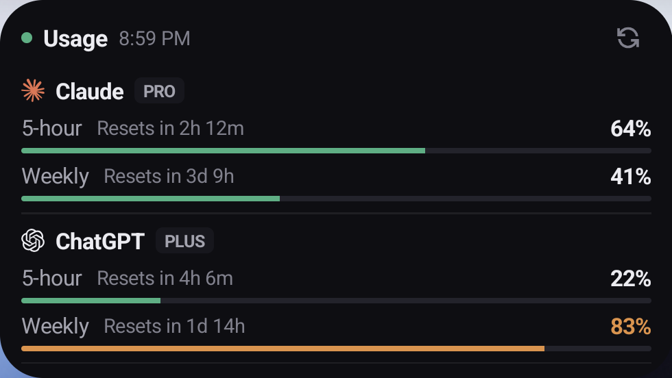
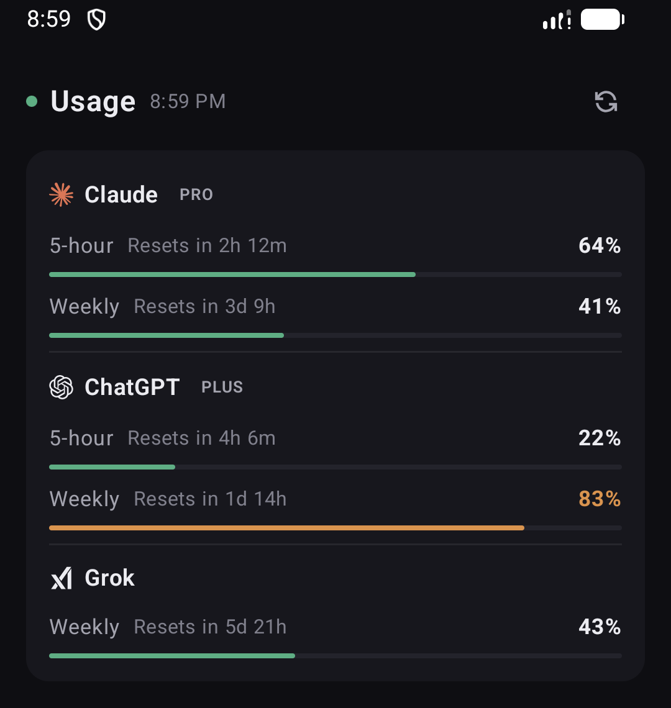

# AI Usage Tracker for Android

A home-screen widget with your Claude, ChatGPT and Grok limits, in the same bar layout as the desktop widget.



## Install

1. On your phone, open the [latest release](https://github.com/Pengopal/ai-usage-tracker-widget/releases/latest)
   and download `AI-Usage-Tracker-<version>.apk`.
2. Open it. Android asks to allow installs from your browser the first time: allow it, then **Install**.
3. Open **AI Usage** and tap **Sign in** next to each provider you use.
4. Long-press the home screen → **Widgets** → **AI Usage**, or tap **Add widget to home screen** in the app.

Needs Android 8.0 or newer. A Play Store version is planned; until then the APK is the way in.

## Using it



- **The widget** shows one line per limit: its name, "Resets in …" and the percentage, with a bar under it that
  turns orange at 70% and red at 90%. Tap it to open the app; tap ↻ to refresh.
- **Refreshing:** Android schedules a background refresh every 15 minutes while you're online. Tap ↻ on the
  widget to request a priority refresh with the app closed. The widget shows when the request is queued or syncing.
- **Providers:** show or hide each one, pick your plan (or leave it on Auto-detect), move them up or down, and
  sign out. The widget follows the same choices.
- **Signing in** opens the provider's own login page inside the app. The page closes by itself once the app can
  read your usage. Email, Google and X sign-in all work; Google opens in a window on top and closes by itself.

<br clear="right">

## Updates

The app checks GitHub for a newer release when you open it. When one is out, **About → Update** downloads the
APK and hands it to Android's installer, which asks you to confirm. The first time, Android asks you to allow
installs from AI Usage: allow it and tap **Update** again.

The Play Store build (`play` flavour) has no updater; the store updates it.

## Data and privacy

Your logins are the providers' normal cookies, kept in the app's private WebView storage. Readings and settings
are in the app's private `usage.json`. Nothing is backed up or sent anywhere except to the three providers and
to GitHub's releases API. **Sign out** deletes that provider's cookies and site data; uninstalling removes all of
it.

## Develop

Needs JDK 17 or newer and the Android SDK (Android Studio works). Run everything from `android/`:

```bash
cd android
```

```bash
./gradlew testGithubDebugUnitTest
```

```bash
./gradlew installGithubDebug
```

| Path | What lives there |
| --- | --- |
| `app/src/main/java/…/core/` | Kotlin ports of the shared catalog, row-building and formatting |
| `app/src/main/java/…/sync/` | WorkManager sync, the WebView that runs the shared readers, sign-out |
| `app/src/main/java/…/widget/` | The Glance home-screen widget |
| `app/src/main/java/…/ui/` | The app screen, sign-in screen and the bar view |
| `app/src/github/` | The GitHub self-updater (`github` flavour) |
| `app/src/play/` | The no-updater stub (`play` flavour) |
| `app/src/test/` | Unit tests, including the row fixture shared with `core/` |

The build copies [`core/src`](../../core/src) into the APK's assets, so the readers that run in the provider's
page are the same files the desktop runs. Edit them in `core/`.

### Flavours

| Flavour | For | Updates |
| --- | --- | --- |
| `github` | The APK attached to GitHub releases | Self-updates from GitHub releases |
| `play` | A future Play Store listing (`./gradlew bundlePlayRelease`) | Through the Play Store |

## Release signing

Every APK must be signed with the same key, or installed copies can't update. The release workflow signs with a
key kept in repository secrets; without them it skips the APK and warns.

1. Create a key once and keep a backup somewhere safe. Losing it means users must uninstall to update.

   ```bash
   keytool -genkeypair -v -keystore release.jks -alias aiusage -keyalg RSA -keysize 4096 -validity 10000
   ```

2. In **Settings → Secrets and variables → Actions**, add:

   | Secret | Value |
   | --- | --- |
   | `ANDROID_KEYSTORE_BASE64` | `base64 -w0 release.jks` (PowerShell: `[Convert]::ToBase64String([IO.File]::ReadAllBytes("release.jks"))`) |
   | `ANDROID_KEYSTORE_PASSWORD` | The keystore password |
   | `ANDROID_KEY_ALIAS` | `aiusage` |
   | `ANDROID_KEY_PASSWORD` | The key password |

3. Never commit the `.jks` file (`.gitignore` blocks `*.jks` and `*.keystore`).

For the Play Store, enrol in Play App Signing and upload the `play` bundle signed with this key as the upload key.
