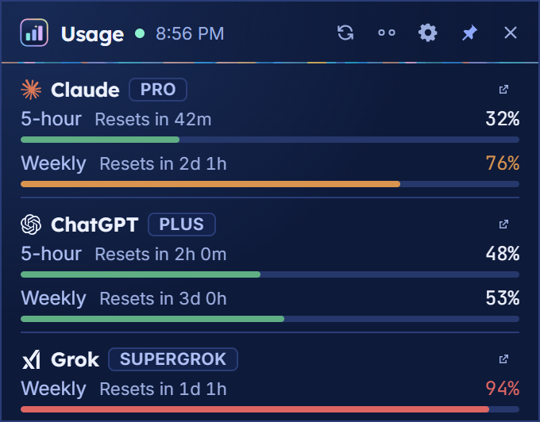
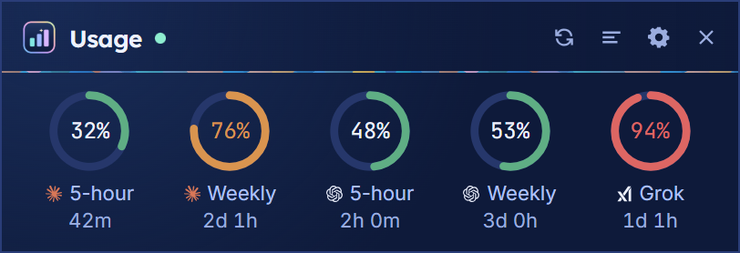
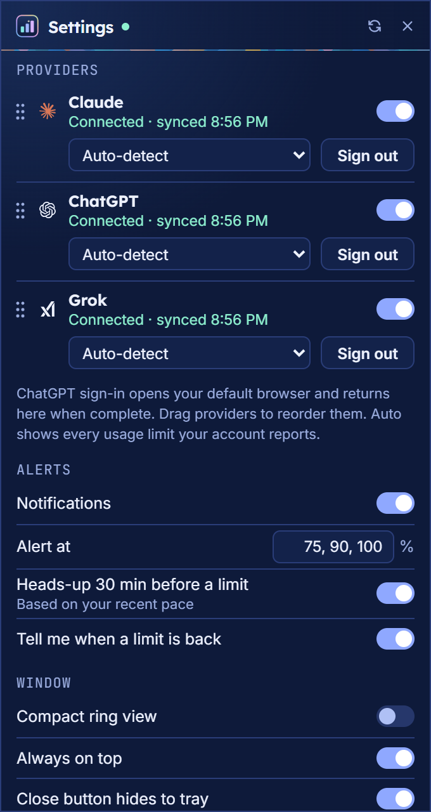

# Pengopal AI Usage Tracker for Windows

## The problem

Claude, ChatGPT and Grok all ration usage in windows — five hours, a week — and each hides its meter on a
different settings page. You find out you're out when a reply stops halfway.

AI Usage Tracker keeps every limit in one small, always-on-top window, refreshed every minute, and warns you
while there's still time to slow down.

## Features

### Every limit at a glance

One line per limit: its name, when it resets, and how much you've used, with a thin bar under it. Bars turn
orange at 70% and red at 90%.

| Detailed | Compact rings |
| :---: | :---: |
|  |  |

### Warnings before you run out

- **Pace heads-up**: from your last hour of use, the widget works out when a limit will run out. If that's
  before it resets, you get a notification about 30 minutes ahead.
- **Threshold alerts** at the percentages you choose (75, 90 and 100% by default), once per reset window.
- **Limit-back alert** when a limit you'd nearly used up resets.

### Your plan, your providers



Each provider has a switch to show or hide it and a plan picker. **Auto-detect** shows every limit your account
reports and labels the plan it finds. Picking a plan shows only that plan's limits — for example, Claude
**Max 20x** shows just the weekly limit. Drag a provider by its handle (or focus the handle and use the arrow
keys) to set the order the widget lists them in.

| Provider | Limits shown | Plans |
| --- | --- | --- |
| Claude | 5-hour, weekly | Free, Pro, Max 5x, Max 20x, Team, Enterprise |
| ChatGPT (Codex limits) | 5-hour, weekly | Free, Plus, Pro, Business, Enterprise |
| Grok | Weekly pool | Free, SuperGrok, SuperGrok Heavy, X Premium, X Premium+ |

### Stays out of the way

Frameless and draggable, sizes itself to its content, remembers where you put it, and lives in the tray. It
updates itself from GitHub Releases and shows an **Update** button when a new version is ready.

<br clear="right">

## Install

1. Download `AI-Usage-Tracker-Setup-<version>.exe` from the
   [latest release](https://github.com/Pengopal/ai-usage-tracker-widget/releases/latest) and run it.
2. Click **Sign in** next to each provider you use.

Until the installer is code-signed, Windows SmartScreen shows "Windows protected your PC" the first time:
click **More info → Run anyway**. [CODE-SIGNING.md](CODE-SIGNING.md) explains why and how signing
is set up.

The portable `AI-Usage-Tracker-Portable-<version>.exe` runs without installing but can't update itself.

To start with Windows: `Win + R` → `shell:startup` → put a shortcut to the app there.

## Signing in

**ChatGPT** opens your default browser, where you can continue with Google or another method offered by OpenAI.
After authorization, a local callback returns you to the widget and refreshes your Codex usage. The installer
and portable app include the Codex runtime used for this connection.

**Claude and Grok** open a provider sign-in window. The window closes once the app can read your usage.
The app uses a private browser profile for those sessions. Choose **Sign out** in Settings to disconnect a provider.


## How it reads your usage

ChatGPT uses the [Codex App Server](https://developers.openai.com/codex/app-server). Claude and Grok use
their respective web sessions in hidden provider windows.

| Provider | Endpoint | Gives |
| --- | --- | --- |
| Claude | `claude.ai/api/organizations/{org}/usage` (behind Settings → Usage) | 5-hour and weekly %, resets, plan tier |
| ChatGPT | Codex `account/rateLimits/read` | Codex 5-hour and weekly %, resets, plan |
| Grok | `grok.com/rest/grok/credits` (falls back to `/rest/rate-limits`) | Weekly pool %, reset |

The website endpoints can change without notice. The widget shows sync errors and keeps the last successful readings.
The web readers save their latest raw usage response as `sync-debug-<provider>.json` for debugging.

**Gemini isn't supported.** Google blocks sign-in inside embedded app windows, and the Gemini app doesn't
expose your usage anywhere the widget could read it.

## Data and privacy

Local settings and readings live in `%APPDATA%\AI Usage Tracker Widget\`:

| File | Holds |
| --- | --- |
| `usage-data.json` | Last readings and settings |
| `history.json` | Seven days of readings, for the pace heads-up |
| `sync-debug-*.json` | The last raw usage response per provider |
| `Partitions\` | The web login sessions |
| `chatgpt-codex\` | The isolated Codex App Server profile |

Codex keeps its credentials in Windows Credential Manager. Sign out in the widget to remove them.

## Develop

Requires [Node.js](https://nodejs.org/) 22. Run everything from `desktop/`:

```bash
cd desktop
```

```bash
npm install
```

```bash
npm start
```

```bash
npm test
```

Build the installer and portable exe into `desktop/dist/`:

```bash
npm run build
```

Each script first copies the shared [`core/src`](../../core/src) into `desktop/src/core/` (git-ignored), so edit
the readers, parsers and catalog in `core/`, never in the copy.

| Path | What lives there |
| --- | --- |
| `desktop/src/main.js` | Window, tray, sync loop, alerts, IPC |
| `desktop/src/sync.js` | Embedded web sessions and shared readers |
| `desktop/src/chatgpt.js` | ChatGPT browser sign-in and Codex usage reads |
| `desktop/src/store.js` | Readings, settings and history on disk |
| `desktop/src/updater.js` | Updates from GitHub Releases |
| `desktop/src/renderer/` | The widget UI |
| `desktop/test/` | Desktop-only tests (`node --test`) |
| `core/src/` | Shared with Android: catalog, readers, parsers, rows, insights |

See [CONTRIBUTING.md](../../CONTRIBUTING.md) before opening a pull request.

## Releasing

Desktop and Android ship together from one tag; see [Releasing](../../README.md#releasing).

## Security

Please report vulnerabilities privately — see [SECURITY.md](../../SECURITY.md).
